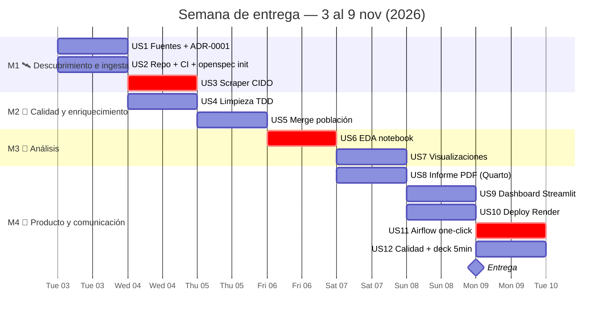
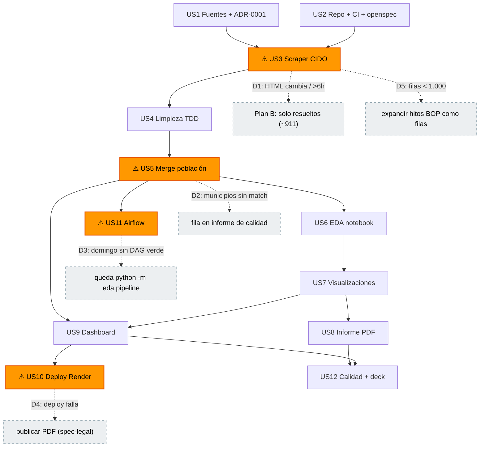

# 📋 PRD — Producto de datos: Oposicions CIDO (Proyecto EDA)

> **Qué es este archivo**: el documento de visión de producto **antes** de crear nada en GitHub. Se valida con tres sombreros — **PO** (¿el alcance responde al CEO?), **SM** (¿las historias son estimables y están ordenadas?), **PM** (¿el calendario y los riesgos cierran?) — y a partir de su aprobación se generan milestones, issues y labels. Es el contrato: si algo no está aquí, no se construye.

## 1. Objetivo del producto
Convertir el registro público de procesos selectivos locales (**CIDO DIBA**, `cido.diba.cat/oposicions`) — **solo materia "Informàtica. Noves tecnologies"** (`filtreMateria=24`: 237 procesos, todos los estados; 79 con plazo abierto/pendiente a 3-nov-2026 — primera ficha: borsa de tècnic superior informàtica, DIBA) — en un producto de datos: datos limpios, las 3 preguntas de negocio respondidas, un informe ejecutivo, un dashboard público y un pipeline reproducible orquestado con Airflow — ejecutado como lo haría una empresa (TDD, PRs, CI, deploy).

**Cumplimiento de la spec (≥1.000 filas)**: el dataset analítico es **formato largo** — 1 fila = 1 hito de proceso (237 procesos × 5-12 hitos BOP/DOGC ≈ 1.500-2.500 filas), más la tabla de procesos como dimensión. En formato ancho (237 filas) NO cumpliría: por eso la expansión de hitos es **core del plan**, no un fallback.

**Métricas de éxito** (= rubric de la spec, `docs/business/CLIENT_SPECS.md`): nivel 🔴 Experto completo; notebook Restart-&-Run-All limpio; URL pública accesible; pipeline de un comando reproducible por un tercero.

## 2. Alcance y fuera de alcance

| ✅ Dentro | ❌ Fuera (documentado, no oculto) |
|---|---|
| 237 procesos IT (materia 24) + hitos BOP en **formato largo** (~1.500-2.500 filas, core del plan) | Otras materias/provincias y sector privado (fallback: añadir materias tecnológicas adyacentes = decisión explícita del PO) |
| Merge con población municipal (INE/DIBA) → `places_per_mil_hab`, `durada_mesos` | Identidades de aspirantes: nombres y NIF completos (solo **recuentos y puntuaciones agregadas** — minimización de datos) |
| **Aspirantes desde PDFs adjuntos (oportunista)**: se recoge SOLO si el PDF existe y parsea; los fallos se **clasifican y reportan** (ver taxonomía en US3) → `competencia = aspirantes/plaza` | Servicios de pago (orquestración gestionada, warehouses, monitoreo) |
| 12 user stories en 4 milestones de empresa | |
| Airflow local (Docker) + dashboard en Render | |

## 3. Riesgos principales
1. **Scraper fragilidad** (HTML sin API): mitigación = caché resumible + tests del parser + plan B "solo resueltos".
2. **M4 concentra 5 US en 2,5 días**: mitigación = regla de corte definida (§ Calendario).
3. **Presupuesto ~33 h ajustado**: lo absorbe el buffer del domingo; nunca a costa de tests/informe.
4. **Enlaces muertos frecuentes** (reportado por el usuario; los adjuntos viven en `diba.cat/documents` y DOGC, no en CIDO) + **PDFs heterogéneos**: mitigación = reintentos con backoff, **taxonomía de errores E1/E2/E3** (caído / intranet genérica / no parseable) → informe de calidad con acción sugerida, y `n_aspirantes` solo donde el PDF exista y parsee (nulo documentado en el resto).
5. **El cumplimiento de ≥1.000 filas depende de la expansión de hitos** (237 procesos): mitigación = formato largo core desde US3 + fallback D5 (materias adyacentes, decisión del PO).

## 4. Roadmap y puntos de desvío (overview)

### 4.1 Línea de tiempo (M1 → M4)



`crit` = camino crítico: si se retrasa, mueve la fecha de entrega.

### 4.2 Grafo de dependencias con desvíos



### 4.3 Tabla de desvíos (disparador → plan B)

| # | Disparador | Plan B | Coste |
|---|---|---|---|
| D1 | El HTML del CIDO cambia o el scraper pasa de 6h | Scrapear solo los ~911 resueltos (o menos fichas por estado) | Filas ↓, EDA intacto |
| D2 | Municipios sin match en INE/DIBA | Quedan sin normalizar, documentados en informe de calidad | Menor |
| D3 | Domingo sin DAG verde | Cae Airflow; queda `python -m eda.pipeline` (un comando) | Demo pierde UI; nota intacta |
| D4 | Deploy de Render falla / fricción | Dashboard local + enlace público al informe PDF | Experto "publicación" spec-legal |
| D5 | Menos de 1.000 filas tras expandir hitos | Añadir materias tecnológicas adyacentes (decisión explícita del PO, documentada en ADR) | +crawl ligero, preguntas intactas |
| D6 | Enlaces de adjuntos caídos (frecuente) o PDFs con formato distinto | Reintentos + log de caídos; `n_aspirantes` solo con PDF válido (nulo documentado) | *Stretch* decae a feature de metadatos (n_docs) sin tocar el core |

---

# 🏭 Ciclo de desarrollo — Cómo ejecuta este proyecto una empresa (simulación)

> **Marco**: somos el equipo de datos de una consultora. El CEO de un cliente entrega un dataset que nadie ha mirado y pide datos limpios, con sentido y la historia que hay detrás (ver `docs/business/CLIENT_SPECS.md`).
>
> Cada historia indica: el ejercicio 🧪 **production-way** que haremos, el nivel de la spec que cubre (🟢🟡🟠🔴) y su **Definition of Done**.

## Principios (de `AGENTS.md`, no negociables)

1. Nada llega a `main` sin PR revisado y CI en verde.
2. **TDD**: primero el test, después la función. Aplica a toda la lógica, no solo al final.
3. Conventional commits y conventional branches (`feat/...`, `docs/...`, `test/...`).
4. Cada PR actualiza los docs que afecta (README, GLOSSARY, ADRs).
5. Un nivel bien hecho vale más que dos a medias.

## Sombreros: los roles que interpretas (todos eres tú)

| Rol | Responsabilidad | Historias |
|---|---|---|
| 🎩 Product Owner | Preguntas de negocio, prioridades | US1, US8 |
| 🔧 Data Engineer | Ingesta, pipeline, tests, Docker, Airflow, deploy | US2–US5, US9–US11 |
| 🔍 Data Analyst | EDA, features, visualizaciones | US5–US7 |
| 📢 Data Storyteller | Informe ejecutivo, presentación | US8, US12 |
| 🖥️ DevOps | Render, CI, publicación | US10–US11 |

Una empresa separa estos roles; aquí los interpretas en serie. El tablero de Issues
hace visible el proceso igual que lo haría en una empresa.

## Milestones (fases de empresa) y labels

Un issue solo puede estar en UN milestone de GitHub → **las fases de empresa son los milestones** y **el nivel de la spec es una label transversal**.

| Milestone | Fase | US | Fechas | Entregable ("release") |
|---|---|---|---|---|
| **M1** 🛰️ | Descubrimiento e ingesta | US1–US3 | Lun 3 – Mar 4 | Fuentes evaluadas + ADR-0001 · repo con CI verde · `data/raw/` cacheado + profiling |
| **M2** 🧹 | Calidad, limpieza y enriquecimiento | US4–US5 | Mar 4 – Mié 5 | Suite pytest verde · ADRs de limpieza · dataset limpio + normalizado |
| **M3** 🔬 | Análisis exploratorio y visualización | US6–US7 | Jue 6 – Vie 7 | Notebook EDA end-to-end · 3 preguntas respondidas · gráficos static + plotly |
| **M4** 🚀 | Producto de datos y comunicación | US8–US12 | Vie 7 – Dom 9 | Informe PDF · dashboard en URL pública · Airflow one-click · calidad + deck |

**Labels por historia** (en GitHub; el rol queda como línea del doc). Bloqueo = dependencias nativas de GitHub (`blocked_by`), no labels.

| US | M | Rol | `complejidad` | `nivel` | Bloqueado por |
|---|---|---|---|---|---|
| US1 | M1 | PO + Data Eng | baja | esencial | — |
| US2 | M1 | Data Eng + DevOps | baja | esencial | — |
| US3 | M1 | Data Eng | alta | esencial, experto | US1, US2 |
| US4 | M2 | Data Eng | alta | esencial, medio, experto | US3 |
| US5 | M2 | Data Eng + Analyst | media | avanzado | US1, US4 |
| US6 | M3 | Analyst | alta | esencial, medio, avanzado | US4, US5 |
| US7 | M3 | Analyst + Storyteller | media | esencial, avanzado | US5, US6 |
| US8 | M4 | Storyteller | media | medio, experto | US6, US7 |
| US9 | M4 | Data Eng + Analyst | alta | avanzado, experto | US5, US7 |
| US10 | M4 | DevOps | media | experto | US9 |
| US11 | M4 | Data Eng + DevOps | alta | experto | US5 |
| US12 | M4 | Storyteller | media | experto | US8, US9 |

## Flujo de trabajo por historia (la ceremonia)

```
issue → branch feat/us3-scraper-cido → tests (rojo) → código (verde)
      → PR → CI pytest verde → review → merge a main → issue cerrado
```

**Definition of Done común** (además del **AC de la issue**, que es la fuente de verdad — formato y proceso en `docs/agents/acceptance-criteria.md`):

- [ ] Tests escritos antes que la función y en verde
- [ ] Notebook (si toca) se ejecuta Restart & Run All sin errores
- [ ] Docs afectados actualizados (README / GLOSSARY / ADR)
- [ ] PR revisado y mergeado con conventional commit

---

## Historias

### US1 — Fuentes de datos como decisión de producto 🟢
*La primera historia de una empresa no es analizar: es decidir de qué datos se alimenta el producto.*

- 🎓 **Clase**: usar el dataset que sugiere el profe.
- 🏭 **Empresa**: evaluar fuentes contra criterios explícitos (licencia, frescura, cobertura, calidad documentada), firmar un *data contract* y dejar la elección registrada.
- 🧪 **Ejercicio production-way**: evaluar las fuentes candidatas contra los criterios de la spec (≥1.000 filas, ≥8 columnas, mezcla de tipos, suciedad real, interés) en una tabla comparativa → **ADR-0001: elección de fuentes**. **Fuente principal: CIDO DIBA** (`cido.diba.cat/oposicions` — procesos selectivos de los ayuntamientos de la província de Barcelona; ~911 resueltos + activos, HTML sin API → scraper). **Fuente de enriquecimiento: población por municipio** (INE/DIBA) para normalizar plazas per cápita. Descartadas: COVID Tracking (congelado 2021: pipeline diario fake), Bicing, aire, accidentes.
- **Las 3 preguntas de negocio** (el CEO las aprueba aquí, el notebook las responde en US6):
  1. *¿Cuánto tarda en resolverse un proceso selectivo IT municipal?* (tiempo convocatoria→resolución por grupo de titulación, sistema y municipio)
  2. *¿Dónde están los puestos IT y cómo está la competencia?* (plazas por municipio normalizadas por población: rural vs urbano · competencia = aspirantes/plaza **donde el PDF de bolsa exista**)
  3. *¿Qué perfil IT piden los ayuntamientos y cuándo?* (grupos de titulación — ¿FP (C1/C2) o grado/posgrado (A1/A2)? — + estacionalidad de convocatorias)
- **Límite documentado**: sin identidades de aspirantes (nombres/NIF completos) — solo recuentos y puntuaciones agregadas de los PDFs públicos de bolsa/resultados; procesos sin PDF válido → `n_aspirantes` nulo y documentado.
- **AC**: issue #1 — pasos de verificación (fuente de verdad del DoD)

### US2 — Entorno y repo reproducible 🟢
- 🎓 `pip install` global, "works on my machine".
- 🏭 Entornos pinned, lockfile, CI desde el primer commit.
- 🧪 `uv` venv + `requirements.txt` generado + `.gitignore` (`data/`, `.venv`) + estructura `src/eda/` + GitHub Actions que lanza `pytest` en cada PR + tablero de Issues (4 milestones M1–M4, 12 stories, sub-issues técnicas).
- **AC**: issue #2 — pasos de verificación (fuente de verdad del DoD)

### US3 — Ingesta reproducible y profiling 🟢🔴
- 🎓 Descargar un CSV a mano y re-descargar cada sesión.
- 🏭 Orquestación (Airflow), zona raw inmutable en S3, cargas incrementales, reintentos.
- 🧪 **No hay API: hay que scrapea** (como en muchas empresas reales). `src/eda/scrape.py` con `requests` + `BeautifulSoup`: filtra por **materia 24 (Informàtica. Noves tecnologies)** → ~5 páginas de listado y **237 fichas** (crawl ligero); **educado** (pausa entre peticiones, User-Agent propio), **resumible** (cache HTML en `data/raw/html/`, no re-pide lo ya descargado), **idempotente** (re-ejecutar no duplica). Los adjuntos viven en `diba.cat/documents` y DOGC: cada enlace se registra con su **slug semántico** (`publtaubor`, `restexambo`, `listexamop`…) y los fallos se **clasifican para acción** en el informe de calidad: `E1 caído` (404/timeout tras reintentos) · `E2 intranet genérica` (enlaza al portal del ayuntamiento, no al documento concreto) · `E3 PDF no parseable` (formato inesperado). `src/eda/profile.py` → reporte de nulos/tipos/valores raros por campo, insumo del informe de calidad.
- **AC**: issue #3 — pasos de verificación (fuente de verdad del DoD)

### US4 — Limpieza con TDD 🟢🟡🔴
- 🎓 Arreglos celda a celda, sin registrar el porqué.
- 🏭 Capa de transformaciones versionada (dbt), cada regla revisada e idempotente.
- 🧪 Funciones puras en `src/eda/clean.py`, **test primero para cada una**: parsear la fecha de convocatoria desde el identificador (`20230127O46` → 2023-01-27) y validarla contra las fechas de la ficha; extraer plazas del título ("N placa/places de…" — catalán y castellano); normalizar categorías (grupos de titulación A1…C2, sistema de selección); fechas dd/mm/yyyy → datetime; procesos sin hitos de resolución (¿incompletos o vigentes?). Cada decisión grande = un ADR (`docs/adr/`).
- **AC**: issue #4 — pasos de verificación (fuente de verdad del DoD)

### US5 — Enriquecimiento y normalización 🟠
- 🎓 Comparar totales absolutos (Barcelona ciudad siempre "gana").
- 🏭 Joins versionados contra dimensiones certificadas; métricas normalizadas por diseño.
- 🧪 `merge` con **población por municipio** (INE/DIBA) → `places_per_mil_hab`; enriquecer con comarca y tamaño de municipio (urbano/rural por población) para comparar segmentos; feature clave: `durada_mesos` = resolución − convocatoria. **Enriquecimiento 2 (*stretch, oportunista*): aspirantes desde PDFs** — `src/eda/pdf_aspirants.py` (pypdf): para fichas con PDF de bolsa/resultados (`publtaubor`/`restexambo`), contar filas de la tabla (patrón NIF enmascarado `***1234**` + puntuación) → `n_aspirantes` y `competencia = n_aspirantes / plazas`. Se recoge **solo si existe y parsea**; cada fallo queda clasificado (E1/E2/E3, ver US3) con acción sugerida en el informe de calidad. **Sin nombres ni NIFs en el dataset** — solo recuentos (minimización de datos, práctica de empresa).
- **AC**: issue #5 — pasos de verificación (fuente de verdad del DoD)

### US6 — Análisis EDA + feature engineering 🟢🟡🟠
- 🎓 Celdas ad-hoc; el resultado vive solo en el notebook.
- 🏭 Notebooks solo para explorar; lo reutilizable se promueve a módulo revisado.
- 🧪 Notebook narrativo (markdown entre celdas) que **importa** la lógica de `src/eda/`: univariado (≥3 variables: duración, plazas, grupo de titulación), bivariado (≥3: duración por grupo/sistema, plazas vs población, mes de convocatoria vs grupo), outliers por IQR (duraciones extremas: ¿procesos atascados?), `groupby`/`agg`/`pivot_table`, ≥3 features nuevas, matriz de correlación + heatmap, tendencias temporales (convocatorias por mes/año) con transformación justificada (**media móvil 12 meses** sobre la serie mensual, o **escala log** para la distribución sesgada de duraciones). Responde por escrito las 3 preguntas de US1.
- **AC**: issue #6 — pasos de verificación (fuente de verdad del DoD)

### US7 — Visualizaciones 🟢🟠
- 🎓 5 gráficos con los colores por defecto.
- 🏭 Sistema de diseño, tipo de gráfico elegido por pregunta, accesibilidad.
- 🧪 Estáticos (matplotlib/seaborn) para el informe + interactivos (plotly) para el dashboard; una función de estilo compartida; ≥5 con título, ejes y leyenda. Estrellas previstas: boxplot de duración por grupo de titulación, ranking de municipios en plazas per cápita, heatmap de estacionalidad (mes × año), serie mensual con media móvil.
- **AC**: issue #7 — pasos de verificación (fuente de verdad del DoD)

### US8 — Informe ejecutivo 🟡🔴
- 🎓 Capturas de notebook pegadas en un doc.
- 🏭 Narrativa dirigida a decisiones ("so what"), rebuild con un comando.
- 🧪 Quarto: `docs/informe/informe.md` → PDF de 1–2 páginas con 3–4 gráficos, cero código, estructura de historia (situación → hallazgo → recomendación). Auditor: "el CEO no lee código".
- **AC**: issue #8 — pasos de verificación (fuente de verdad del DoD)

### US9 — Dashboard interactivo 🔴🟠
- 🎓 "Aquí tienes mi repo".
- 🏭 App desplegada, acceso controlado, monitorizada.
- 🧪 Streamlit (`app.py` + `src/eda/`): el CEO filtra por municipio/grupo de titulación/estado/fecha y ve los KPIs (duración media por grupo, plazas per cápita, calendario de convocatorias); usa el dataset limpio del pipeline, sin recompute del EDA.
- **AC**: issue #9 — pasos de verificación (fuente de verdad del DoD)

### US10 — Deploy y publicación 🔴🧪
- 🎓 URL del repo como "entrega".
- 🏭 CI/CD desde `main`, contenedor, rollbacks, monitoreo.
- 🧪 **Docker real** (Dockerfile abajo) + **render.yaml** → Render builda la imagen y auto-despliega desde `main`; URL pública. Informe + slides como static site (Render static o Pages mirror). *Free tier: duerme a los 15 min; ~30 s de cold start — aceptable para demo.*
- **AC**: issue #10 — pasos de verificación (fuente de verdad del DoD)

### US11 — Orquestación real con Airflow (Docker) 🔴🧪
*En producción nadie ejecuta el proceso a mano: un orquestador lo corre, lo monitoriza y lo reintenta. Aquí lo hacemos con el mismo software que usa una empresa.*

- 🎓 **Clase**: nada — un notebook corrido a mano y listo.
- 🏭 **Empresa**: Airflow en un servicio gestionado (Astronomer, MWAA, Composer), DAGs programados, alertas, UI de monitoreo.
- 🧪 **Ejercicio production-way**: **Airflow real corriendo en Docker** (astro-cli, ver Apéndice B). El DAG `eda_oposicions` ejecuta NUESTROS módulos de `src/eda/` (scan/download → profile → clean → enrich → validate → export) con `data/` montado por volumen — **ingesta incremental sobre una fuente viva**: el scan detecta procesos nuevos o con nuevos hitos BOP y solo descarga lo que falta (idempotencia de verdad, no re-scrapear 1.000 fichas). **One click** = botón ▶ en la UI de Airflow (localhost:8080): el graph view pinta cada tarea en verde mientras TODO el proceso corre — escanear, limpiar, validar y exportar. Eso es el reflejo de prod.
- **Conceptos que pasan de teoría a práctica**: idempotencia (re-ejecutar no duplica), dependencias entre tareas, logs por tarea, reintentos, catchup.
- **AC**: issue #11 — pasos de verificación (fuente de verdad del DoD)

### US12 — Informe de calidad + presentación 🔴
- 🎓 "Los datos estaban sucios y los limpié".
- 🏭 Data quality report con pendientes y riesgos; comité de comunicación del hallazgo.
- 🧪 `docs/informe-calidad-datos.md` (qué faltaba, qué se corrigió, qué quedó pendiente y por qué — resume los ADRs) + deck revealjs de 5 min con storytelling para público no técnico (Quarto presentation).
- **AC**: issue #12 — pasos de verificación (fuente de verdad del DoD)

---

## Apéndice A — Docker (artefacto real)

```dockerfile
FROM python:3.12-slim
WORKDIR /app
COPY requirements.txt .
RUN pip install --no-cache-dir -r requirements.txt
COPY src/ ./src/
COPY app.py .
COPY data/processed/ ./data/processed/
EXPOSE 8501
CMD ["streamlit", "run", "app.py", "--server.port=8501", "--server.address=0.0.0.0"]
```

Render puede desplegar con este Dockerfile (`render.yaml`, servicio web free, `dockerfilePath: ./Dockerfile`, `autoDeploy: true` desde `main`).

## Apéndice B — Airflow REAL en Docker (astro-cli)

Setup una vez (~30 min la primera vez, luego segundos):

```bash
brew install astro-cli          # CLI de Astronomer: Airflow dockerizado listo
astro dev init                  # crea airflow/ (dags/, .env, docker-compose base)
# montar nuestro código y datos: añadir volumes en el docker-compose override
#   ./src:/project/src  y  ./data:/project/data
astro dev start                 # levanta webserver + scheduler + postgres (Docker)
```

El DAG (`airflow/dags/eda_oposicions.py`) llama a los **mismos módulos** que `python -m eda.pipeline` — no hay lógica duplicada, solo orquestación encima:

```python
from datetime import datetime
from airflow import DAG
from airflow.operators.python import PythonOperator
import sys; sys.path.insert(0, "/project/src")
from eda import download, profile, clean, enrich, validate, export

with DAG("eda_oposicions", start_date=datetime(2023, 1, 1),
         schedule=None, catchup=False) as dag:          # manual: se dispara con ▶
    t1 = PythonOperator(task_id="scan_download", python_callable=download.run)  # US3 (incremental)
    t2 = PythonOperator(task_id="profile",  python_callable=profile.run)        # US3
    t3 = PythonOperator(task_id="clean",    python_callable=clean.run)          # US4
    t4 = PythonOperator(task_id="enrich",   python_callable=enrich.run)         # US5
    t5 = PythonOperator(task_id="validate", python_callable=validate.run)       # quality gate
    t6 = PythonOperator(task_id="export",   python_callable=export.run)         # US9 insumo
    t1 >> t2 >> t3 >> t4 >> t5 >> t6
```

**El "one click"**: abrir `localhost:8080` → DAG `eda_oposicions` → ▶ → el graph view
pinta las tareas en verde mientras se ejecuta TODO el proceso (escaneo incremental →
limpieza → validación → export). En una empresa esto corre en un servicio gestionado
(Astronomer/AWS MWAA/GCP Composer) con `schedule="0 6 * * *"` y alertas; local con
Docker es **el mismo software**, sin coste.

*Por qué `schedule=None`: disparo manual para la demo; en prod se programa diario.*
*Requisito: Docker Desktop corriendo (ya instalado, v29). Coste: ~2–3 h del presupuesto.*

## Apéndice C — Lo que una empresa añade de verdad (y aquí saltamos)

| Herramienta | Para qué | Por qué no aquí |
|---|---|---|
| dbt | Transformaciones versionadas en SQL | Proyecto pequeño, pandas basta |
| Great Expectations | Validación de datos como tests | pytest cubre el gate |
| S3 / warehouse | Zona raw inmutable, historia | Local + gitignored |
| Airflow gestionado (Astronomer, MWAA, Composer) | Orquestación en la nube, alertas, SLAs | Corremos Airflow local con Docker (US11) — mismo software |
| Monitoreo (Datadog…) | Alertas de caída del pipeline | Render notifica fallos de deploy |

## Calendario (~33 h, entrega ~dom 9 nov)

| Día | Historias | Horas |
|---|---|---|
| Lun 3 | US1 + US2 (repo, CI, tablero) | 3 |
| Mar 4 | US3 (scraper CIDO completo + profiling) | 6 |
| Mié 5 | US4 + US5 (limpieza TDD + merge población) | 5 |
| Jue 6 | US6 (EDA completo en notebook) | 5 |
| Vie 7 | US7 + US8 (gráficos + informe PDF) | 5 |
| Sáb 8 | US9 + US10 (dashboard + Render) | 5 |
| Dom 9 | US11 (Airflow one-click) + US12 + pulido | 4 + buffer |

*El presupuesto se mantiene ~33 h: el filtro materia 24 aligera el crawl (237 fichas en vez de ~1.000, −2 h) y compensa el stretch de PDFs de aspirantes (+2 h). Sobre las 30 h originales, el sobrecoste restante es Airflow real (+2-3 h).*

**Regla de corte si falta tiempo** (en este orden): 1º cae la orquestación Airflow
(queda `python -m eda.pipeline`: un solo comando, mismo proceso, sin UI); 2º cae el
hosting del dashboard (se publica el enlace al PDF, la spec lo permite). **Nunca**
caen el pipeline, los tests ni el informe.
