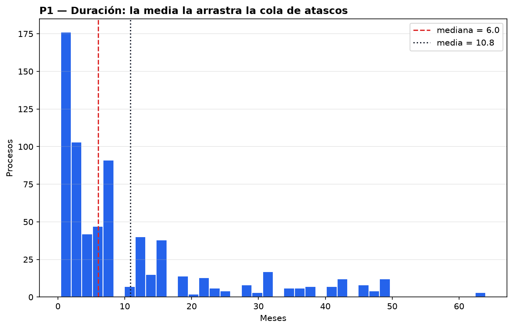
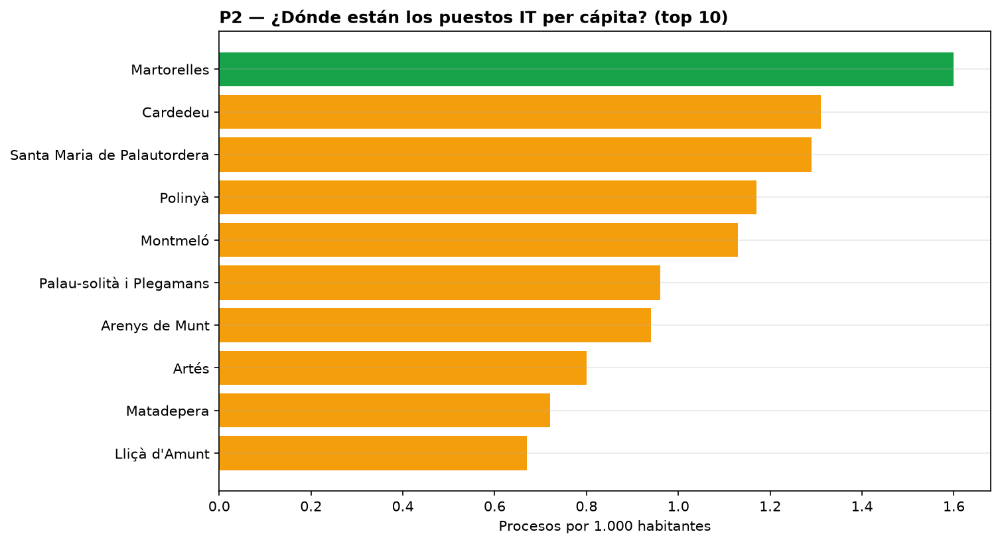
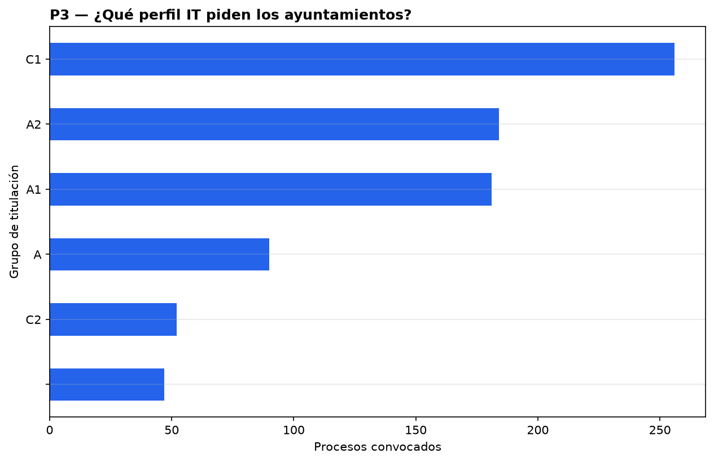

# La situación

La administración local de los alrededores de Vic convoca **814 procesos selectivos
de informática** (2006–2026, 216 municipios en un radio de 45 km, ~1,4 M habitantes).
Hemos procesado el registro público del CIDO — todos los anuncios, bases, listas y
resoluciones de cada proceso (2.690 hitos documentados tras la limpieza) — aplicando
tres criterios: datos **agregados y públicos** (ningún dato personal de aspirantes,
por diseño RGPD), **trazabilidad total** (cada decisión en ADRs, cada cifra reproducible
con `task pipeline`) y **normalización honesta** (lo desconocido es vacío, no inventado).

# Hallazgos

## 1. La duración real: 4 meses en resolverse, no los que aparentan

Solo **149 procesos** tienen duración computable (convocatoria → resolución publicada).
Su mediana es de **3,9 meses**, pero la media sube a 9,2: existe una cola de procesos
atascados — el más largo, **64 meses** — que distorsiona cualquier promedio simple.
Por tamaño de municipio, los intermedios (5–20k hab) son los más rápidos (mediana
4,4 meses) y los urbanos los más lentos (7,4).

## 2. Las oportunidades per cápita: los pueblos pequeños lideran

Normalizando por población, el ranking se invierte: **Martorelles** (rural, 1,6 procesos
por 1.000 hab) y **Cardedeu** o **Santa Maria de Palautordera** (intermedios, ~1,3)
encabezan la lista; los municipios grandes, fuera del top. Para quien busca plaza,
el canal no es solo el área metropolitana.

## 3. El perfil demandado: C1 y A2, con estacionalidad marcada

El perfil dominante es **C1 (FP/grado superior, 256 procesos)** seguido de A2 y A1
universitarios. Por sistema, dominan los concursos de méritos (3 de cada 4): menos
oposición de examen, más bolsa de méritos. La estacionalidad muestra picos de
convocatoria en **febrero–marzo** y valle claro en **agosto**.

# Recomendación

1. **Para candidatos IT**: vigilar el canal CIDO en febrero–marzo, priorizar
   municipios intermedios y rurales (más oferta per cápita y resoluciones más
   rápidas) y preparar el perfil C1, el más demandado.
2. **Para la organización cliente**: el dataset y el dashboard quedan operativos
   con actualización diaria automática (pipeline versionado, tests y despliegue
   continuo) para seguir la evolución sin esfuerzo adicional.

# Limitaciones honestas

- La duración solo es computable en procesos con resolución publicada (**18%**);
  los abiertos y los incompletos quedan fuera de esa métrica.
- **341 procesos (42%)** no exponen fecha de convocatoria parseable (identificadores
  fuera del formato estándar) — documentados en el informe de calidad.
- Los procesos de entidades supramunicipales (Diputació, universidades: 432) no
  tienen denominador de población y no entran en el análisis per cápita.
