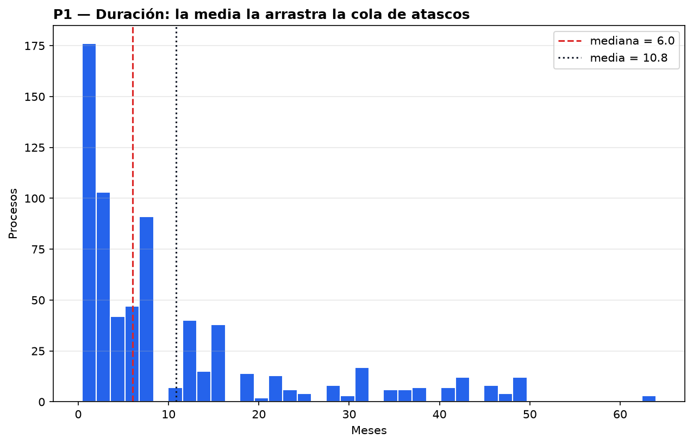
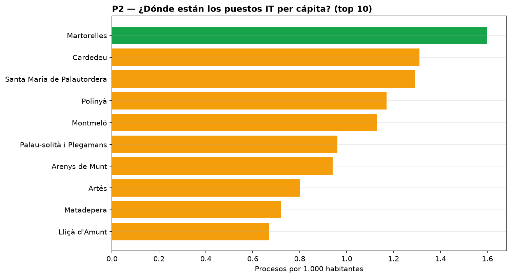
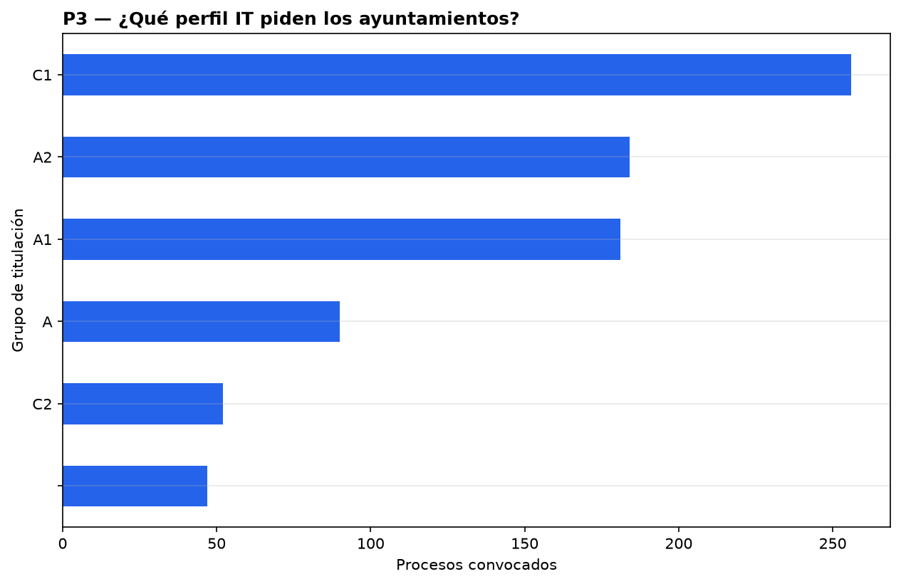

## El reto: separar el mito del dato real {.smaller}

Quien busca o planifica empleo público de informática en la administración local suele asumir dos cosas:

1. *"Las oposiciones tardan años en resolverse."*
2. *"Las oportunidades reales solo están en las grandes ciudades."*

Analizamos **todos los registros públicos del CIDO (Diputació de Barcelona)** en un radio de **45 km desde Vic** (2004–2026):

- **814 procesos selectivos** de informática y nuevas tecnologías.
- **2.690 hitos oficiales** (BOPB / DOGC) limpios y auditados.
- **Cero datos personales** (diseño RGPD: solo metadatos de las plazas, nunca de aspirantes).

::: {.notes}
Tiempo estimado: 45 segundos. Presentar el contexto sin tecnicismos: 814 convocatorias reales auditadas desde el registro oficial CIDO.
:::

---

## El hallazgo principal {.smaller}

> **Los municipios pequeños e intermedios convocan más plazas IT por habitante y las resuelven en ~4 meses (frente a >7 meses en los grandes municipios).**

:::: {.columns}

::: {.column width="50%"}
### Velocidad real
- **Mediana global**: **3,9 meses** desde la convocatoria hasta la resolución.
- La fama de lentitud (media de **9,2 meses**) la provoca un **8,7 % de procesos atascados** (hasta 64 meses).
- Los municipios **intermedios (5k–20k hab.)** resuelven en **4,4 meses** de mediana; los **urbanos (>20k hab.)** suben a **7,4 meses**.
:::

::: {.column width="50%"}
{width="95%"}
:::

::::

::: {.notes}
Tiempo estimado: 1 minuto 15 segundos. Este es el único gran hallazgo que la audiencia debe recordar: la mediana es de 4 meses y la ventaja está en los municipios pequeños e intermedios.
:::

---

## ¿Dónde están las oportunidades per cápita? {.smaller}

Al dividir las plazas por la población de cada municipio, el mapa se invierte a favor de los municipios rurales e intermedios:

:::: {.columns}

::: {.column width="45%"}
- **Martorelles** (rural, <5.000 hab.): **1,63 procesos por cada 1.000 hab.**
- **Cardedeu** y **Santa Maria de Palautordera** (intermedios): **~1,28 procesos / 1.000 hab.**
- Los grandes ayuntamientos tienen más volumen absoluto, pero mucha menor densidad por habitante y trámites más largos.
:::

::: {.column width="55%"}
{width="95%"}
:::

::::

::: {.notes}
Tiempo estimado: 1 minuto. Mostrar cómo el ajuste per cápita cambia la decisión de dónde buscar o dónde competir por talento IT.
:::

---

## ¿Qué perfil se busca y cuándo salir a buscarlo? {.smaller}

:::: {.columns}

::: {.column width="45%"}
- **El perfil estrella es técnico (Grupo C1 — FP Grado Superior)**: **256 procesos**, por delante de los perfiles universitarios A2 (155) y A1 (126).
- **3 de cada 4 procesos** seleccionan por **concurso o bolsa de méritos**, no por oposición clásica pura.
- **Ventana clave**: pico claro en **febrero–marzo** y parón en **agosto**.
:::

::: {.column width="55%"}
{width="95%"}
:::

::::

::: {.notes}
Tiempo estimado: 1 minuto. Conectar el hallazgo con el calendario y el tipo de titulación más demandada.
:::

---

## Recomendación y honestidad de los datos {.smaller}

:::: {.columns}

::: {.column width="55%"}
### Qué hacer mañana
1. **Candidatos y centros de formación FP (C1)**: apuntar a bolsas y concursos de **municipios de 5.000 a 20.000 habitantes** entre **febrero y marzo**.
2. **Ayuntamientos grandes (>20k hab.)**: acortar los **7,4 meses** de resolución para no perder técnicos frente a municipios vecinos que resuelven en 4 meses.
:::

::: {.column width="45%"}
### ¿Qué NO sabemos aún?
- **Cuántos aspirantes compiten por plaza**: las listas viven en PDFs heterogéneos y con datos protegidos por RGPD.
- **La duración del 82 % de procesos** que siguen abiertos o no publicaron su último edicto en CIDO.
:::

::::

::: {.notes}
Tiempo estimado: 1 minuto. Cerrar en menos de 5 minutos totales con una acción concreta y transparencia sobre las limitaciones del dato.
:::
